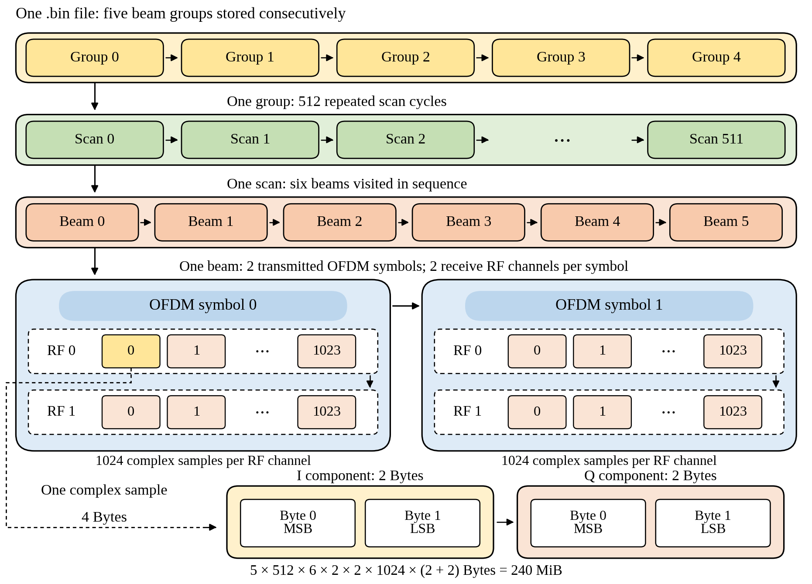
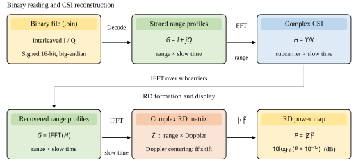

# Data format

## Raw collection structure

```text
<dataset_root>/
└── 2025_12_09_12_00/
    ├── mmw/
    │   ├── 22/
    │   │   └── *.bin
    │   └── 23/
    │       └── *.bin
    ├── camera/           # RGB / infrared video
    ├── meteorological/  # Weather observations
    └── uav/             # Timestamped UAV flight records
```

The directories present depend on the collection. A collection identifier groups associated records; individual files retain their own timestamps.

## Binary measurements

<p align="center">
  
</p>

<p align="center"><em>Storage hierarchy of one complete .bin sweep, from beam groups to individual I/Q bytes. Indices are zero-based.</em></p>

One complete `.bin` file contains a 30-beam sweep: five groups of six beams, 512 repeated scans per group, two OFDM symbols per beam visit, two receive channels, and 1,024 complex samples per symbol/channel. I and Q are interleaved signed 16-bit big-endian integers. The complete sweep occupies 251,658,240 bytes (240 MiB).

The stored samples are a range-domain representation of CSI after acquisition-side FFT processing. The reader transforms the selected samples into a frequency–slow-time channel matrix; RD processing provides range and radial-velocity coordinates. Beam indices are `0–29`; symbol and receive-channel indices are `0–1`.

## .bin to CSI to RD

<p><a href="../assets/img/bin-csi-rd.svg" target="_blank" rel="noopener"></a></p>

For one selected beam, OFDM symbol, and receive channel, the reader and RD processor use the following steps:

| Stage | Public toolkit operation | Representation |
| --- | --- | --- |
| Decode `.bin` | Read signed 16-bit big-endian values and combine interleaved I and Q as `I + jQ` | Stored range profiles: range × slow time |
| Reconstruct CSI | Apply `fft(axis=0)` to the range profiles | Complex CSI: subcarrier × slow time |
| Form complex RD | Apply `ifft(axis=0)`, then `ifft(axis=1)`, then `fftshift(axes=1)` | Range × Doppler |
| Display RD | Compute squared magnitude for power, or `10*log10(power + 1e-12)` for log-power | RD power map or dB image |

Each matrix has 1,024 rows and 512 columns. The diagram's `H = Y/X` describes CSI relative to the transmitted reference; the binary reader starts from archived I/Q and reconstructs CSI with an FFT rather than repeating this division. The visualization workflow also applies the toolkit's range-bias calibration before plotting.

[Open the full-size diagram](../assets/img/bin-csi-rd.svg) · [Download a PNG copy](../assets/img/bin-csi-rd.png) · [Run the visualization workflow](quickstart.md#trajectory-and-collection-window-visualization)


## Timestamp alignment

RF filenames use TAI and UAV RTK records use UTC. The toolkit subtracts 37 seconds for the current release and retains its legacy zero-offset exception for January–May 2026 files. Use the actual timestamp provenance for those older captures.
